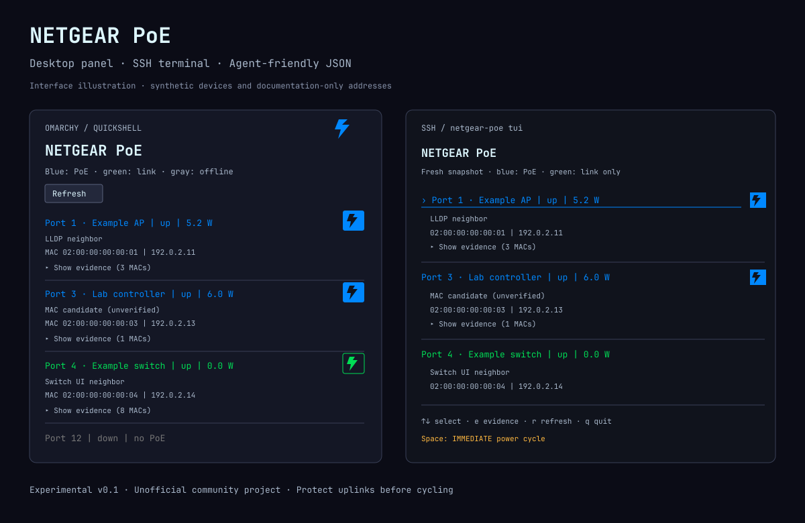

# netgear-poe

[](https://github.com/dnappier/netgear-poe/actions/workflows/ci.yml)
[](https://github.com/dnappier/netgear-poe/releases)

**NETGEAR AV port monitoring and PoE power cycling from your desktop, SSH terminal,
or AI agent.** Rust CLI + TUI + Omarchy Quickshell plugin; no cloud service.

**Experimental v0.1.** Read-only operations tested against an
M4250-10G2XF-PoE++ running firmware 13.0.4.14. Other models/firmware are not
validated. Native reset payload has mock coverage; live hardware reset/recovery
is not yet verified. Linux/Unix credentials permissions are enforced.



Preview is an illustration with synthetic devices/addresses, not a live capture.
Actual desktop UI inherits your Omarchy font/theme. TUI uses terminal typography.

```text
Agent skill ─┐
             ├─ netgear-poe CLI ─ JSON AV API ─ NETGEAR switch
Omarchy panel┘       │
                     └─ ~/.netgear-poe.toml (0600)
```

## Install the CLI / TUI

Download the static Linux archive matching your CPU from
[Releases](https://github.com/dnappier/netgear-poe/releases), plus `SHA256SUMS`.
`x86_64` is most desktop PCs; `aarch64` is ARM64. Verify before installing:

```sh
sha256sum --ignore-missing -c SHA256SUMS
tar -xzf netgear-poe-v0.1.0-x86_64-unknown-linux-musl.tar.gz
# Review any existing ~/.local/bin/netgear-poe before replacing it.
install -Dm755 netgear-poe ~/.local/bin/netgear-poe
netgear-poe --help
```

Ensure `~/.local/bin` is on your PATH. No root permissions required. Alternatively
build from source with a current stable Rust toolchain:

```sh
git clone https://github.com/dnappier/netgear-poe.git
cd netgear-poe
cargo test --locked
cargo install --locked --path .
```

Cargo installs to `~/.cargo/bin`; ensure that directory is on your PATH. CLI and
TUI need no Omarchy/Wayland session. Optional MAC manufacturer database:
`/usr/share/hwdata/oui.txt` (Arch package `hwdata`).

## Credentials and setup

From the source checkout, use the standard-library-only Python 3 setup helper:

```sh
python3 scripts/setup-config.py --url http://192.168.1.250 --username admin
```

Password is prompted with hidden input, never passed as an argument. Helper
creates `~/.netgear-poe.toml` with mode 0600 and refuses to overwrite an existing
file. Requires Python 3; setup-helper tests require 3.11+. Binary archives include
`config.example.toml` for manual setup instead:

```sh
(umask 077; set -C; cat config.example.toml > ~/.netgear-poe.toml)
${EDITOR:-nano} ~/.netgear-poe.toml
```

**Before cycling, edit `protected_ports` to protect uplinks and critical gear.**
Example password is a placeholder; actual credentials never belong in this
repository. HTTP exposes passwords and sessions to LAN observers;
prefer HTTPS when supported, with a trusted certificate. TLS verification is
always enabled. Requests bypass proxies and never follow redirects. Sessions
stay in memory and logout is attempted when each command finishes.

## Commands

```sh
netgear-poe info
netgear-poe ports
netgear-poe port 6
netgear-poe devices --port 6
netgear-poe --json ports
netgear-poe cycle 6 --dry-run
netgear-poe cycle 6 --yes
netgear-poe cycle 3 6 7 --yes
```

Global flags: `--config PATH`, `--json`. JSON output is a versioned envelope:
`{"schema_version":1,"ok":true,"data":...}`. Operational errors use `ok:false`
and exit 1. Argument errors use clap stderr/exit 2. `ports` prints a compact table;
other commands print JSON details. Power is converted from milliwatts to watts.
Raw switch/PoE fields are preserved. Link state 0 = up, 1 = down; other values
remain unknown.

The neighbor API supplies LLDP and ARP records. Preserve all records per port
and source type. These include downstream devices and potentially stale records;
vendor labels are not necessarily hostnames. No device identity is invented.

### MAC identity and physical attachment

Each port now includes `attachment` and `poe_powered`. Full MACs are normalized
and deduplicated. Manufacturer lookup uses the local `/usr/share/hwdata/oui.txt`
database if available (no external API requests). Locally administered MACs are
not assigned manufacturer names. An OUI identifies a manufacturer, not a model.
Optional `[device_names]` in credentials TOML maps full MACs to friendly names.

Attachment states:
- `lldp_neighbor`: one unique LLDP MAC; best available neighbor evidence, not
  unconditional physical proof (forwarded/stale LLDP is possible).
- `single_mac_candidate`: one learned MAC without LLDP; direct attachment unverified.
- `switch_ui_neighbor`: multiple LLDP neighbors; display the first neighbor row
  exactly as NETGEAR AV UI does. Extra neighbors remain in evidence/candidates;
  this selection does not independently verify physical attachment.
- `ambiguous`: multiple MACs without a unique neighbor or a usable UI preference.
- `unknown`: no usable identity or link down/unknown; stale records are not selected.

The panel shows the neighbor/candidate's MAC, manufacturer, name and IP instead
of presenting every downstream host as directly attached. Raw learned records
remain available under expandable evidence and in CLI JSON.

Per-port control uses the same lightning glyph as the bar icon. Foreground and
background are swapped when PoE is actually delivering; normal colors mean no
delivery. Unknown delivery gets a warning border; non-PoE ports cannot reset.
Delivery comes from native PoE state (2 = delivering, 1 = searching), falling
back to measured watts only if state is absent. This is not link state or merely
administrative PoE enablement. Clicking immediately performs a power cycle,
without a confirmation dialog, not a persistent on/off toggle. Protected-port
checks and busy-state blocking remain enforced. Refresh reads actual state;
no fake off animation. Typography matches GitHub plugin's shared title/body/
caption tokens rather than Qt's larger default control fonts.

Known device names (or MAC manufacturer names) appear immediately after the port
number: `Port 3 · MultiTracks.com, LLC | up`. Both interfaces follow the NETGEAR
web UI's state palette: blue = delivering PoE (even if link down), green = link
up without PoE delivery, gray = offline without power, amber = unknown state.
Powered lightning buttons remain inverted. TUI selection uses an underline and
marker, so highlighting does not replace the state color.

### Reset safety

Reset uses the exact native AV UI contract:
`POST /api/v1/swcfg_poe_reset` with `{"poePortConfig":{"portId":[6]}}`.
No artificial off-time, no persistent configuration change, no switch reboot.

- Explicit numeric port selection and `--yes` required. No implicit `all`.
- Dry run fetches and validates live data, but never posts resets.
- All selections validated before mutation. Duplicates removed; ascending order.
- Reject non-PoE, disabled, protected, unknown/ambiguous ports and stacked units.
- One port per request, sequential acceptance (not sequential recovery).
- Stop on first failure, report previously accepted ports. No automatic retry.
- Accepted reset is not proof of reboot/recovery. Timeout may mean it happened.
- Protect uplinks, critical equipment and management-path ports with
  `protected_ports = [1, 4]` after checking your topology. Defaults protect none.
- Native reset interrupts PoE only; self-powered equipment cannot be rebooted.
- Concurrent CLI invocations are not serialized; do not run overlapping resets.

**No live reset has been performed during development.** Read-only discovery
and dry runs are safe to validate; choose a safe test port before hardware reset.

## SSH terminal UI

```sh
netgear-poe tui
ssh -t user@your-machine 'netgear-poe tui'
netgear-poe --config /path/to/credentials.toml tui
```

TUI mirrors the Quickshell panel: compact port rows, horizontal separators,
MAC-based neighbor identity, expandable learned evidence, and inverse lightning
colors when delivering PoE. Uses your terminal font/palette; no graphical session
or Wayland forwarding required. UTF-8 terminal recommended; mouse support depends
on SSH client/terminal. Minimum size: 35 columns × 10 rows.

| Key | Action |
| --- | --- |
| ↑ / ↓ or k / j | Select port |
| Home / End | First / last port |
| Enter / e | Expand/collapse selected port's evidence |
| PageUp / PageDown | Scroll selected port's details |
| r | Read fresh snapshot |
| Space | Immediately power-cycle selected port — no confirmation |
| q / Esc / Ctrl-C | Exit (finishes an in-flight request first) |

Click a row to select; click its lightning icon to immediately power-cycle.
Protected/disabled/non-PoE ports are rejected. One request at a time; repeated
actions while busy are ignored. All mutations revalidate against live switch
data, and reset acceptance is followed by read-only refresh, never an automatic
reset retry. Network I/O runs off the UI thread. Terminal mode is restored on
normal exit, errors and Rust panics. No `--json` in interactive mode.

## AI agent skill

`skills/netgear-poe/SKILL.md` is a portable agent skill. Install the directory in
your agent's skills location, e.g. `~/.agents/skills/netgear-poe/`. Install CLI
first and ensure it is on the agent's PATH. Skill requires explicit authorization
for disruptive targets; credentials never enter agent prompts.

## Omarchy plugin

Root `manifest.json` and `Panel.qml` form the plugin, ID `dnappier.netgear-poe`.
Install CLI first: the plugin does not download or build executables automatically.
Requires Omarchy Quattro's installed shell
`Panel`, `KeyboardPanel`, and theme components. Opens a fresh snapshot, shows
MAC-based neighbor identity with expandable learned evidence, and offers a
single-click immediate reset for each lightning-button port. No background
polling or automatic retries. CLI revalidates before every mutation.

```sh
omarchy plugin add https://github.com/dnappier/netgear-poe.git --enable
omarchy plugin enable dnappier.netgear-poe --section right
# If imports are cached, restart the shell:
omarchy restart shell
```

Ensure `netgear-poe` is on the shell process's PATH. Plugin can be used alongside
CLI/TUI; do not run overlapping resets. No installer changes switch configuration
or credentials. Like other Quickshell plugins, it runs unsandboxed with your user
permissions. See [SECURITY.md](SECURITY.md).

Update and remove:

```sh
omarchy plugin update dnappier.netgear-poe --yes
omarchy plugin remove dnappier.netgear-poe
```

Update CLI separately from Releases or `cargo install --locked --path .` in an
updated checkout. Removing the plugin preserves CLI, agent skill and credentials.
To remove those too, review and delete only your installed `netgear-poe` executable,
`~/.agents/skills/netgear-poe/` and `~/.netgear-poe.toml`; no broad cleanup needed.

## Development and license

See [CONTRIBUTING.md](CONTRIBUTING.md) for tests and local QML validation. Licensed
under [MIT](LICENSE). Unofficial community software: not affiliated with,
endorsed by or supported by NETGEAR. NETGEAR is its owner's trademark.
